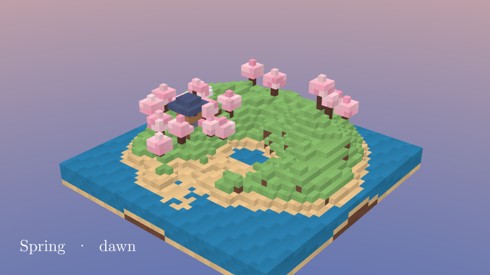

# Voxel Studio

Four small voxel projects, each built from one prompt to [Claude Code](https://claude.com/claude-code).
No code here was written by hand. The exact prompts are in [PROMPTS.md](PROMPTS.md).

It started with two GitHub links, [ManimGX](https://github.com/academa-labs/manimgx) and
[BUI](https://github.com/ppmpreetham/BUI), and the question "can we use both together?"

| Step | What it is | Where |
|---|---|---|
| 1 | Island generator with a Blender-style control panel | `app.py`, `world.py`, `render_job.py` |
| 2 | "A Year on a Small Island", a 30-second film generated by code | `film.py`, output in `out/` |
| 3 | A living world in the browser: day and night, seasons, weather, birds, villagers | `web/` |
| 4 | Miniature City, a playable city builder with roads, power, jobs and saving | `web/city/` |
| + | The scripts that made the short video about all of this | `video/` |



## Run the browser projects

They need only Python 3 to serve the files; there is no build step.

```
python live.py          # the living world
python live.py city     # Miniature City
```

Then open `http://127.0.0.1:8137/` (or `/city/`). Three.js is vendored in `web/vendor/`.

Miniature City controls: left-click builds, right-drag rotates the camera, middle-drag pans, scroll zooms.
Keys: R rotate, B bulldoze, V select, Esc cancel, Space pause. The city saves in your browser.

Rule checks (Node 18+):

```
cd web && node tests/sim.test.mjs
cd web/city && node tests/city.test.mjs
```

## Run the island generator and the film

These use ManimGX and BUI:

```
python -m venv .venv
.venv\Scripts\pip install -r requirements.txt
.venv\Scripts\python app.py          # control panel
.venv\Scripts\python film.py         # renders the film (slow: about 20 minutes at 720p)
```

## The video

`video/make_video.py` assembles the vertical short from captured frames, `add_audio.py` adds music and
scene sounds, and `add_voice.py` adds a voice-over with [Kokoro](https://github.com/thewh1teagle/kokoro-onnx).
The frames, music and voice model are not in the repository; the scripts explain what they expect.

Music used in the published video: "Midsummer" by iamoneabe, CC0, from
[OpenGameArt](https://opengameart.org/node/140425).

## Known limits

- Miniature City's balance is rough, the island is flat, and power is city-wide (no power lines).
- Touch controls and the phone layout exist but were not tested on a real device.
- The film renderer is offline only.

## License

MIT for the code in this repository (see [LICENSE](LICENSE)). Three.js in `web/vendor/` is MIT, by its authors.
